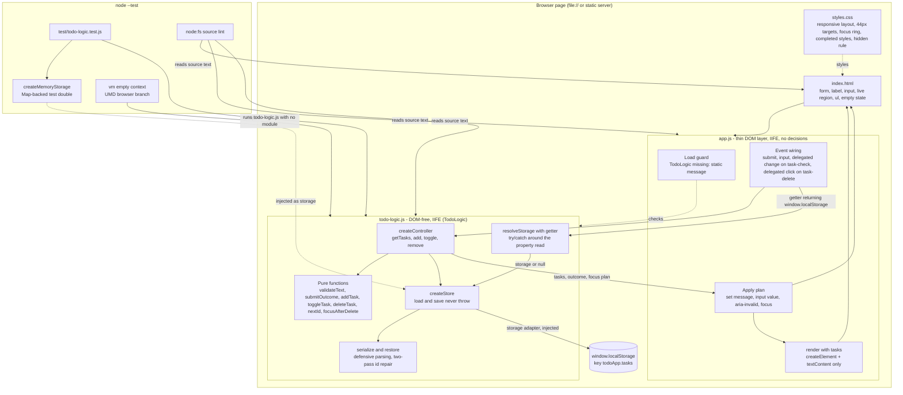

# KAN-3 Architecture: Browser Todo app with persistent tasks

Input: `artifacts/KAN-3/requirements.md` (approved; FR-1..11, NFR-1..8, AC-1..15, A-1..11, open-question defaults Q-1..Q-7 accepted).
Status: v2. Design-review findings DR-1..DR-14 (`artifacts/KAN-3/design-review.md`) and the user's answers OQ-1..OQ-4 are applied. Section 12 lists what changed where. No requirement changes (Scope change: none).

## 1. Stack recommendation

### 1.1 Recommendation

Plain HTML, CSS and ES2017+ JavaScript, loaded with **classic `<script src>` tags** (no `type="module"`, no `crossorigin`). The logic lives in one file with a **UMD-style dual export**: in a browser it attaches `TodoLogic` to `globalThis`; under Node (`require`) it sets `module.exports`. A second file holds the DOM layer, which only maps results from the logic file onto the page (4.2). There is no build step, no runtime dependency and no network request. Node's built-in test runner (`node --test`) is dev-only tooling.

Both JavaScript files are wrapped in an IIFE with `"use strict"` (DR-9). The only global the app creates is `TodoLogic`. Classic scripts share one global lexical scope, so same-named top-level declarations in the two files would collide and kill `app.js`. The IIFE removes that risk.

Why this satisfies the hard requirements:
- AC-14 / NFR-1 / NFR-2: `index.html` works from `file://` because classic scripts have no CORS or origin restrictions. That holds only while no `crossorigin` attribute and no `type="module"` are added, and a test guards it (8.1).
- NFR-8 / NFR-3: `test/todo-logic.test.js` does `require("../todo-logic.js")` and exercises every decision (validation, submit outcome, focus planning, storage resolution, restore) with no browser and no install.
- NFR-5: the DOM layer is the only place user text meets the DOM, and it uses `textContent` and `setAttribute` only. A source-lint test guards this (8.1).

### 1.2 Alternatives considered

| Option | For | Against | Verdict |
|---|---|---|---|
| A. Classic scripts, UMD-style dual-export logic file + separate `app.js` | Works from `file://` in evergreen browsers (AC-14). `require()`-able from Node with no config (NFR-8), and loadable in a `vm` context to test the browser branch. Clean logic/UI split. | A few lines of wrapper boilerplate. Load order matters (`defer` in order). One global: `TodoLogic`. | **Chosen** |
| B. Native ES modules | Modern syntax. No globals. | Chromium and others block module scripts from `file://` (origin `null`), so double-clicking `index.html` fails (AC-14). Node needs `"type": "module"` or `.mjs` plus a `package.json`. | Rejected (AC-14) |
| C. Single inline `<script>` | One file. Works from `file://`. | Logic cannot be `require()`d without HTML scraping. Fails NFR-8's intent and NFR-2's "JavaScript file(s)". | Rejected (NFR-8) |
| D. CommonJS-only logic with a hand-copied browser build | Simple tests. | Duplicated code or a build step. Violates NFR-1. | Rejected |
| E. Framework or bundler | Familiar tooling. | Forbidden by NFR-1. | Rejected |
| F. jsdom or Playwright committed as dev dependencies | Automated UI tests in CI. | Adds `package.json`, `node_modules` and installs, beyond NFR-3's "no install" spirit. | Not in the repo. See 8.2 and OD-1. |
| G. Keep submit, focus and storage-resolution decisions inside `app.js` (v1) | Fewer exports. | Those decisions carry AC-8, AC-9, AC-12, AC-13 and AC-15, and with no browser tooling configured they would be unverifiable (DR-4). | Rejected in v2 (OQ-1) |

### 1.3 Trade-offs accepted

- Global `TodoLogic` (one name) in exchange for `file://` compatibility.
- The DOM layer is not unit-tested under Node. It is kept thin (about 100 to 150 lines) and only maps logic results to the page: set message, set input value, render, focus. Browser-only remains: rendering, layout, real focus and pointer behaviour, and CSS (8.2).
- No CSP `<meta>` tag. `script-src 'self'` has inconsistent semantics for `file:` URLs and could break AC-14. Safe rendering (NFR-5) rests on `textContent`, not CSP.
- The native checkbox is a full-row invisible input (4.7), so task text cannot be selected or copied with the mouse or touch. Accepted (DR-1).

## 2. File layout

```
/ (repository root)
  index.html            markup, links styles.css, loads the two scripts
  styles.css            all styling, mobile-first
  todo-logic.js         logic, storage resolution, store, controller (UMD dual export, IIFE, "use strict")
  app.js                DOM layer only (browser-only; IIFE, "use strict"; never required by tests)
  test/
    todo-logic.test.js  node --test suite (node:test, node:assert/strict, node:fs, node:vm)
  (existing: .claude/, artifacts/, docs/, CLAUDE.md)
```

- **No helper files in `test/`.** `node --test` with no arguments executes every `.js`, `.cjs` or `.mjs` file under a `test` directory, plus files named like `*.test.js`, `*-test.js`, `*_test.js` and `test-*.js`. Spy storage, throwing storage and other fixtures live inside the test file. If the suite is split, every file in `test/` must be a real test file.
- **`package.json` is not added.** Without one (and with no ancestor `package.json` setting `"type": "module"`), Node treats `.js` as CommonJS, which the dual-export file needs. Node v26.13.1 is installed (reported by the design review; not run by this document), which satisfies `node --test`, so R-7 is closed. Do not add `"type": "module"` anywhere.
- **Contingency (OQ-3; reopens OD-3 only if it occurs):** if `node --test` fails to load `todo-logic.js` as CommonJS, add a minimal `package.json` with `"private": true` and `"type": "commonjs"` and no dependencies. That needs the user's confirmation and is otherwise not planned.
- `index.html` details:
  - `lang="en"` and `<meta name="viewport" content="width=device-width, initial-scale=1">`.
  - `<link rel="icon" href="data:,">` so a static server is not asked for `/favicon.ico`. A `data:` URL is not a network request.
  - `<link rel="stylesheet" href="styles.css">`.
  - `<script src="todo-logic.js" defer>` then `<script src="app.js" defer>`. Deferred classic scripts run in document order after parsing and work from `file://`. No `type="module"` and no `crossorigin` on any tag.
  - A `<noscript>` line saying the app needs JavaScript.
  - No external fonts, CDNs, images or `http(s)://` or protocol-relative URLs.
- **AC-14 asset count:** the page loads `index.html` plus three subresources (`styles.css`, `todo-logic.js`, `app.js`).

## 3. Component diagram



## 4. Component responsibilities

### 4.1 `todo-logic.js` (no DOM; no `window`, `self`, `document` or `localStorage` identifier anywhere)

- **Wrapper (DR-9).** One IIFE with `"use strict"`. At the end it builds an `api` object. If `typeof module === "object" && module !== null && module.exports` is true it sets `module.exports = api`; otherwise it sets `globalThis.TodoLogic = api`. It never references `window`, `self` or `document`. Nothing else leaks to the global scope.
- **Task model**: `{ id: string, text: string, completed: boolean }`. Array order is display order, oldest first (FR-4). Invariant: `text` is trimmed and non-blank, for tasks added in the app and for tasks restored from storage (DR-11). No other fields (A-3).
- **Text validation** (`validateText`): `trim()` per A-7. Non-string input is blank. Returns the trimmed text, or the `blank` error (FR-2, FR-3).
- **Submit outcome** (`submitOutcome(tasks, raw)`, OQ-1): the single place that decides what a submit means. It returns the next tasks array, the new task or `null`, and the UI plan.
  - Success: `ok: true`, `error: null`, `message: ""`, `inputValue: ""` (FR-10, AC-8), `focus: "input"`.
  - Blank: `ok: false`, `error: "blank"`, `message: MESSAGES.blank`, `inputValue: ""`, `focus: "input"`, tasks unchanged (FR-3, A-5). A blank input is empty or whitespace-only, so clearing it is always correct.
  - The DOM layer only maps this: live-region text, `aria-invalid` (true only when `ok` is false), input value, focus the input.
- **Pure list operations**: `addTask`, `toggleTask`, `deleteTask`. They never mutate their input and return new arrays. An unknown id returns the list unchanged. They act on id only, never on text or index, so duplicate-named tasks stay independent (FR-5).
- **Focus planner** (`focusAfterDelete(tasksBefore, id)`, OQ-1): computed from the list as it was before the delete. Returns `{ kind: "task", id }` with the next task's id, or the previous task's id if the deleted task was last, or `{ kind: "input" }` if no other task remains or the id is unknown. The DOM layer focuses that task's Delete button, or the input. It needs no DOM reads to decide.
- **Id generation** (`nextId`): see 4.4.
- **Codec** (`serialize`, `restore`): converts between task arrays and the stored string. `restore` never throws (4.3).
- **`resolveStorage(getter)`** (OQ-1): calls `getter()` inside `try/catch`. Returns the result only if it is non-null and has function-valued `getItem` and `setItem`. In every other case (the getter throws, returns `null` or `undefined`, or something unusable) it returns `null`. Never throws. This is the AC-12 "property access throws" path, now testable under Node.
- **`createMemoryStorage()`**: a `Map`-backed implementation of the storage contract. It is a **test double only**, not used by the app at runtime (DR-12). It is exported so tests can simulate a refresh.
- **`createStore({ storage, key })`**: wraps an injected storage-like object, or `null` or `undefined` for "no storage". `load()` returns a task array and never throws. `save(tasks)` returns `true` or `false` and never throws. There is no in-memory mirror and no `isPersistent()` (OQ-4). See 4.5.
- **`createController({ store })`**: owns the current task list, loaded once at creation via `store.load()`. **The constructor never calls `store.save`**, even if `load` dropped bad items or repaired ids. A "repair on load" write would break AC-2's zero-write assertion. Repaired data is written on the next real change.
  - `add(raw)` returns the submit outcome and, on `ok`, saves. A rejected add changes nothing and does not call `save` (FR-3).
  - `toggle(id)` returns `true` if a task changed, and saves only then (FR-8).
  - `remove(id)` returns `{ changed: boolean, focus: { kind, id? } }`, using `focusAfterDelete` on the list before the delete. It saves only when something changed (FR-7, FR-8).
  - The controller exists so that "saved after every change", "blank leaves storage untouched" and "the constructor does not write" are testable without a browser.
- **Constants**: `STORAGE_KEY`, `STORAGE_VERSION`, `MESSAGES.blank` (so tests can assert the message).

### 4.2 `app.js` (browser only; maps results, contains no business rules)

IIFE with `"use strict"`. It uses only `index.html` element ids, `window.localStorage` and `TodoLogic`, and exports nothing.

- **Load guard (DR-14).** First statement: if `typeof globalThis.TodoLogic === "undefined"`, replace the contents of `<main>` with a static message via `textContent` (for example "The app could not load. Reload the page.") and return. There is no unhandled error and no navigation. A developer-error path, but now defined.
- **Startup:** `storage = TodoLogic.resolveStorage(function () { return window.localStorage; })`, then `createStore({ storage })`, `createController({ store })`, then `render(controller.getTasks())`. `app.js` has no `try/catch` around storage access; that is `resolveStorage`'s job.
- **Events:**
  - `submit` on the `<form>` (covers Enter in the input and activating Add). **`event.preventDefault()` is the first statement** of the handler, before anything that could throw (DR-5), so a bug can never navigate to `index.html?task=...`. Then `const out = controller.add(input.value)` and apply the outcome: message text, `aria-invalid`, input value, `render`, focus the input. Optional: to make a repeated identical message re-announce, clear the live region and set the text on the next tick (`setTimeout` 0).
  - `input` on the text field clears the message and `aria-invalid` (A-4).
  - **Toggle:** one delegated `change` listener on the `<ul>`. It acts only if `event.target` is an element with class `task-check`. One user action (pointer, touch, label click, Space) produces exactly one `change` event, so a toggle cannot double-fire (DR-2). It reads the id from the closest `<li>`'s `dataset.id`, calls `controller.toggle(id)`, re-renders and re-focuses that task's checkbox.
  - **Delete:** one delegated `click` listener on the `<ul>`. It acts only if `event.target.closest(".task-delete")` matches. A match on `li`, `.task-main` or the label never decides an action. Clicks with `event.detail > 1` are ignored (OQ-2, DR-7), so a double-click or double-tap cannot delete the next row that slid under the pointer. Keyboard activation has `detail === 0` and is unaffected. It calls `controller.remove(id)` and focuses per the returned `focus` plan.
- **Row lookup (DR-3):** rows are found by iterating `ul.children` and comparing `dataset.id` to the id. The code never builds a CSS selector from an id.
- **Render:** rebuilds the `<ul>` with `replaceChildren`, using `createElement`, `textContent`, `setAttribute` and `dataset`. It shows or hides the empty-state element and the list with the `hidden` attribute (FR-11; see the `[hidden]` rule in 4.7).
- It holds no state beyond DOM references. The controller is the source of truth.

### 4.3 Stored data: key, shape and defensive parsing

- **Key**: `todoApp.tasks`. Namespaced because `file://` pages in some browsers share one `localStorage` bucket across files.
- **Shape** (JSON string):
  ```
  { "version": 1, "tasks": [ { "id": "t1", "text": "Buy milk", "completed": false }, ... ] }
  ```
  Order is the array order.
- **Envelope and version (OQ-4):** the envelope and `STORAGE_VERSION` are kept. Version 1 is the only one written. `restore` does not reject a missing or different version; it validates shape only and ignores the `version` field. The field exists so a later change can migrate deliberately.
- **`restore(raw)` rules** (never throws):
  1. `raw` is `null`, `undefined`, not a string, empty, or fails `JSON.parse` → `[]`.
  2. Parsed value is an array → use it (a bare array is accepted; see OD-6). Parsed value is an object whose `tasks` is an array → use that array. Anything else (number, string, `null`, object without a `tasks` array) → `[]`.
  3. Per item: it must be a non-null object with `typeof text === "string"` and a non-blank `text.trim()`. Otherwise drop it. The kept text is the **trimmed** text (DR-11, OQ-4), so the task-text invariant holds. The valid subset is kept (NFR-7).
  4. `completed` is `true` only if it is exactly `true`. Anything else is `false`.
  5. **Ids, two passes (DR-3, DR-8).**
     - A stored id is *valid* only if it is a string matching `^t[0-9]+$` with at most 15 digits (so `^t[0-9]{1,15}$`) and it is not already in a `Set` of accepted ids.
     - Pass 1: walk the kept items in order. A valid id is accepted and added to the `Set`. Items with an invalid, duplicate or missing id are marked for repair. The first occurrence of a duplicate keeps the id.
     - Pass 2: walk the marked items in order and assign each a fresh id from `nextId` computed over the full `Set` (all accepted ids plus ids assigned so far), adding it to the `Set`.
     - Example: stored ids `["t1", missing, "t1", "t5"]` give `t1`, `t6`, `t7`, `t5`. The result no longer depends on whether a later item holds a valid id that an earlier repair would have taken.
     - Ids such as `a"]`, `__proto__`, `constructor`, `""`, numbers and 16-digit ids are all treated as invalid and replaced.
  6. Fresh objects are built from the three known fields only. Nothing else is copied from parsed data.
- Corrupt data is silently replaced by `[]`. The bad value is overwritten on the next successful save (accepted default for Q-2).

### 4.4 Id generation approach

`nextId(tasks)` collects the ids that match `^t[0-9]{1,15}$` into a `Set`, takes the largest number `max` (0 if none), and returns `"t" + (max + 1)`. As a defence, if that candidate is already in the `Set` it keeps incrementing until it is not. Examples: empty list → `t1`; `t1,t2,t5` → `t6`.

- Unique within the current list by construction (and by the loop for edge cases). Non-matching ids can never equal a `t<number>` id.
- With at most 15 digits, `max + 1` stays well below 2^53, so there is no precision loss (DR-8). Reaching `t1000000000000000` takes a hand-edited `t999999999999999`. It is then a 16-digit id, which a later restore treats as invalid and repairs. That is harmless.
- Deterministic, so tests need no mocked clock or randomness. No `crypto.randomUUID` (secure contexts only, absent on `http://<lan-ip>`), and no `Date.now()` collisions.
- A deleted id can be reused later. This is harmless: deleted tasks are gone from state and storage, ids are never shown (A-8), and the DOM is rebuilt on every change, so no stale reference survives.
- Cross-tab concurrent edits are out of scope (requirements section 7).

### 4.5 Storage adapter and failure handling

- **Contract (a subset of Web Storage)**: `getItem(key) → string | null` and `setItem(key, value) → void`. Either may throw.
- **`resolveStorage(getter)`** turns "reading `window.localStorage` may throw or be absent" into "a usable storage or `null`" (4.1).
- **`createStore` behavior**:
  - `load()`: if no storage, return `[]`. Otherwise try `storage.getItem(key)` and pass the string to `restore`. If `getItem` throws, return `[]`.
  - `save(tasks)`: if no storage, return `false`. Otherwise try `storage.setItem(key, serialize(tasks))` and return `true`. If it throws (blocked, quota exceeded, Safari private mode, and so on) swallow it and return `false`.
  - Every `save` writes the whole list and retries real storage, so a transient failure (for example quota freed after a delete) heals on the next change.
  - There is no in-memory mirror inside the store (OQ-4): the mirror was never read in the app.
- "Keeps working in memory for the session" (NFR-7, AC-12) comes from the design itself: the controller holds the authoritative list regardless of what `save` returns.
- **No visible notice, no hook** (accepted Q-1 default, and OQ-4 dropped `isPersistent()`). If a notice is ever wanted, that is a new decision and a small change to `createStore` and the controller. See OD-2.
- `createMemoryStorage()` (Map-backed) is a test double only (4.1).

### 4.6 Accessibility design

Static markup in `index.html` (ids are illustrative):

- `<main>` with `<h1>`. One `<form id="add-form" novalidate>`. No `required` attribute: native validation bubbles would pre-empt our message, and `required` does not reject whitespace anyway.
- `<label for="task-input">New task</label>` is a visible label (NFR-6), with `<input id="task-input" type="text" autocomplete="off" aria-describedby="task-error">`. The submit control is `<button type="submit">Add</button>`.
- **Validation message (DR-6):** `<p id="task-error" role="alert"></p>`. It is **always rendered, including when idle**. When empty it is collapsed with zero height, margin and padding and `overflow: hidden` (for example `#task-error:empty { height: 0; margin: 0; padding: 0; overflow: hidden }`), and **never `display: none`**, because a `display: none` element is not in the accessibility tree and setting its text would be exactly the "unhide" case a live region handles unreliably. Setting `textContent` triggers the announcement. On a rejected submit also set `aria-invalid="true"` on the input. Clear both on the next `input` event and on the next successful add. Copy: `MESSAGES.blank`, for example "Task cannot be blank. Enter some text and try again." A repeated identical message may not be re-announced by every screen reader. The optional clear-then-set on the next tick mitigates this; otherwise accepted (R-6).
- **Task rows**: `<ul id="task-list">`, each `<li data-id="…">`. The toggle is a **native checkbox**: `<label class="task-main"><input type="checkbox" class="task-check"><span class="task-box" aria-hidden="true"></span><span class="task-text">…</span></label>`. The accessible name is the task text and the state is announced as checked or unchecked. Space toggles natively. Delete is `<button type="button" class="task-delete" aria-label="Delete: <task text>">Delete</button>`. The visible word "Delete" is contained in the accessible name (WCAG label-in-name). The name and `data-id` are set via `setAttribute` or `dataset`, which is safe for user text.
- **Non-color completion indicator** (FR-6, AC-4, NFR-6): a drawn check mark glyph in the box, plus `text-decoration: line-through` on the text, plus the checked state for assistive tech. The tick is a **text glyph** (`content: "\2713"` on `.task-check:checked ~ .task-box::after`) and the box has a `border` in `currentColor`, so forced-colors mode keeps both (a tick made only from background colors can vanish there). Color is only an additional cue.
- **Focus ring (DR-6, DR-1):** the real input is `opacity: 0`, so its own outline is invisible. The ring is drawn on the row with `.task-main:has(.task-check:focus-visible) { outline: 2px solid …; outline-offset: 2px }`. It uses `outline`, not `box-shadow`, so forced-colors mode keeps it. `:focus-visible` (not `:focus-within`) keeps the ring off after mouse clicks. For an engine without `:has()`, `@supports not selector(:has(*))` falls back to the same outline on `.task-check:focus-visible ~ .task-box`. Buttons and the text input keep their native `:focus-visible` outlines, which are never removed, and are at least 2 px with good contrast (AC-13). Verification inspects the computed outline on `.task-main` (or `.task-box`), **not on the input** (8.2).
- **Focus management** (the list is rebuilt on every change, so focus is restored explicitly; the decisions come from the logic layer):
  - After a rejected or successful add: `submitOutcome.focus === "input"`. The input is emptied and focused, so the user can type the next task.
  - After a toggle: re-focus the same task's checkbox, found by iterating `ul.children` and comparing `dataset.id`.
  - After a delete: `controller.remove(id).focus` gives `{ kind: "task", id }` (focus that task's Delete button: the next task's, else the previous task's) or `{ kind: "input" }` (list is now empty).
  - Programmatically focusing the input on touch devices opens the virtual keyboard. Accepted (DR-7).
- **Empty state** (FR-11, AC-15): `<p id="empty-state">No tasks yet. Add one above.</p>`. It is shown and the `<ul>` hidden when there are no tasks.
- The input's font size is at least 16px, so iOS Safari does not zoom on focus.
- Design goal (not a stated requirement): body text contrast of at least 4.5:1.

### 4.7 Responsive CSS approach (NFR-4, AC-7)

- Mobile-first single column. `*, *::before, *::after { box-sizing: border-box }`. `.app` has `max-width: 40rem; margin: 0 auto; padding: 1rem`, which keeps line length sane at 1920 px.
- **`[hidden] { display: none !important }`** (DR-14). Without it, an author rule such as `display: flex` on the same element beats the UA `[hidden]` rule, and the empty state or list would stay visible.
- No `100vw` widths, no fixed pixel widths on containers, and no `overflow-x: hidden` to mask overflow. Overflow is prevented by construction.
- **Add form**: `display: flex; gap: .5rem`. The input has `flex: 1; min-width: 0` (`min-width: 0` stops it forcing overflow at 320 px). The Add button is `flex: none`.
- **Task row**: `<li>` is `display: flex; align-items: stretch; gap: .5rem`. `.task-main` has `flex: 1; min-width: 0; min-height: 44px; display: flex; align-items: center`. `.task-text` has `overflow-wrap: anywhere; word-break: break-word; white-space: normal`, so long unbroken strings wrap (Q-5).
- **Containing block and stacking (DR-1):**
  - **`.task-main { position: relative; isolation: isolate }`.** This is mandatory. Without it the absolutely positioned input would be placed against the initial containing block, stretch over the viewport and intercept every click. `isolation: isolate` keeps the input's `z-index` inside the row, so it cannot cover the Delete button.
  - `.task-check` is `position: absolute; inset: 0; width: 100%; height: 100%; margin: 0; opacity: 0; z-index: 1`. It sits first in the label's DOM order.
  - **`.task-box` and `.task-text` stay non-positioned** (`position: static`). The positioned input then paints above them, so every pointer or touch on the box, the text or the empty row area lands on the input. If a future change must position `.task-box` (for example to draw the tick), the input keeps a higher `z-index` and the plan must say so.
  - The input's bounding box is the full row target (at least 44 px tall and wide), so measuring the input's rect gives an unambiguous result. The Delete button is a sibling of `.task-main`, not inside it.
  - Accepted trade-off: because a full-row input receives the pointer, task text cannot be selected or copied with the mouse or touch.
- **Touch targets**: every control has `min-height: 44px; min-width: 44px` in literal CSS px (so the guarantee holds when the user shrinks the root font size). Add and Delete get horizontal padding. The visible `.task-box` is about 24 px, drawn by CSS, inside the 44 px target.
- **Touch behaviour (DR-7, OQ-2):** `touch-action: manipulation` on buttons (Add and Delete) removes double-tap zoom delay and reduces double-tap deletes. It is combined with the `event.detail > 1` guard in 4.2.
- Spacing between adjacent targets is at least 4 px, so none overlap.
- At 320 px: 16 px page padding leaves 288 px. The input shrinks via `min-width: 0` and the Add button stays at about 64 px. Each row has the label area (flex) and Delete (about 72 px). No breakpoints are strictly required. If needed, one `@media (min-width: 40rem)` adds larger padding and type size. No media query may remove or hide a control.

## 5. Data flow

**Load** (page open): `index.html` loads `todo-logic.js`, then `app.js`. `app.js` checks that `TodoLogic` exists (else shows the static message and stops). It calls `TodoLogic.resolveStorage` with a getter that returns `window.localStorage`, then `createStore`, then `createController`. The controller calls `store.load()`, which reads `todoApp.tasks` and runs it through `restore`. The controller does not write. `render(controller.getTasks())` follows.

**Add**: submit event → `event.preventDefault()` → `controller.add(input.value)` → `submitOutcome` → on success `addTask` (appends `{id: nextId, text: trimmed, completed: false}`) → `store.save` → outcome `{ok: true, message: "", inputValue: "", focus: "input"}`. On blank → outcome `{ok: false, error: "blank", message: MESSAGES.blank, inputValue: "", focus: "input"}` with no save. The DOM layer applies the outcome: set the message and `aria-invalid`, set the input value, re-render, focus the input.

**Toggle**: delegated `change` on `.task-check` → read `data-id` → `controller.toggle(id)` → pure op → `store.save` → re-render → re-focus that checkbox.

**Delete**: delegated `click` matched on `.task-delete` (ignored if `detail > 1`) → read `data-id` → `controller.remove(id)` → pure op → `store.save` → returns `{changed, focus}` → re-render → focus the planned Delete button or the input.

**Reload**: same as Load. Restored tasks have the same text, order and completion state, and deleted tasks are absent (FR-9, AC-6).

## 6. Interfaces

Signatures only (types in comments, not code to copy):

```
// todo-logic.js  -> globalThis.TodoLogic (browser)  |  module.exports (Node)
Task        = { id: string, text: string, completed: boolean }
StorageLike = { getItem(key): string|null, setItem(key, value): void }   // may throw
FocusPlan   = { kind: "task", id: string } | { kind: "input" }
Outcome     = { ok: boolean, error: null|"blank", message: string, inputValue: string,
                focus: "input", task: Task|null }

STORAGE_KEY = "todoApp.tasks";  STORAGE_VERSION = 1
MESSAGES    = { blank: string }

validateText(raw: any)               -> { ok: true, text: string } | { ok: false, error: "blank" }
submitOutcome(tasks, raw)            -> Outcome & { tasks: Task[] }   // unchanged tasks when !ok
nextId(tasks: Task[])                -> string
addTask(tasks, raw)                  -> { tasks: Task[], task: Task|null, error: null|"blank" }
toggleTask(tasks, id)                -> Task[]        // unknown id: unchanged
deleteTask(tasks, id)                -> Task[]        // unknown id: unchanged
focusAfterDelete(tasksBefore, id)    -> FocusPlan     // next, else previous, else input; unknown id: input
serialize(tasks)                     -> string
restore(raw: any)                    -> Task[]        // never throws; two-pass id repair
resolveStorage(getter: () => any)    -> StorageLike|null   // never throws
createMemoryStorage()                -> StorageLike   // Map-backed test double
createStore({ storage, key? })       -> { load(): Task[], save(tasks): boolean }   // never throw
createController({ store })          -> {
    getTasks(): Task[],
    add(raw): Outcome,                              // saves only when ok
    toggle(id): boolean,                            // true if a task changed
    remove(id): { changed: boolean, focus: FocusPlan }
}   // constructor loads once and never calls store.save
```

`app.js` uses only the `index.html` element ids, `window.localStorage` (via a getter passed to `resolveStorage`) and `TodoLogic`. It exports nothing.

## 7. Error behavior

| Situation | Behavior | Req |
|---|---|---|
| Blank add (empty, spaces, tabs, newlines) | No list change, no save. `MESSAGES.blank` in the live region, input `aria-invalid`, input emptied and focused. | FR-3, AC-2 |
| Message shown, user types or adds a valid task | Message and `aria-invalid` cleared. | A-4, AC-9 |
| Second Enter or double-tap on Add right after a successful add | Input is empty, so it is a blank submit and the message appears. Conforms to FR-3. Recorded as accepted behaviour. | FR-3, DR-7 |
| Double-click or double-tap Delete | The second click (`detail > 1`) is ignored. | DR-7 |
| Held Enter or Space on Delete | Auto-repeat can delete further rows, because focus moves to the next Delete. Recorded as an accepted limitation. | DR-7 |
| `window.localStorage` property access throws | `resolveStorage` returns `null`. The store loads `[]` and `save` returns `false`. App fully works for the session, silently. | NFR-7, AC-12 |
| `getItem` throws | Treated as no data. Start empty. | NFR-7 |
| `setItem` throws (blocked, quota) | Swallowed. `save` returns `false`. List stays in memory. Next change retries real storage. | NFR-7, Q-1, Q-7 |
| Stored value is invalid JSON, wrong type, or wrong shape | Start with `[]`. Overwritten on the next save. | AC-11, Q-2 |
| Stored array has bad items | Valid items kept with trimmed text, bad ones dropped. Invalid, duplicate or missing ids repaired in two passes. | NFR-7 |
| Odd ids such as `a"]`, `__proto__`, `constructor` | Replaced by fresh `t<number>` ids. No selector is ever built from an id. | NFR-7, DR-3 |
| Toggle or delete with unknown id | No-op, no save, no throw. | robustness |
| HTML-like input | Rendered as literal text. | NFR-5, AC-10 |
| Very long text, or many tasks | No limit. Text wraps. No quota-specific logic beyond the swallow above. | Q-5, Q-7 |
| Submit handler throws | `preventDefault()` already ran, so the page does not navigate or reload. | DR-5 |
| `TodoLogic` undefined (`todo-logic.js` failed to load) | `app.js` guard replaces `<main>` content with a static message and stops. No unhandled error. | DR-14 |
| JavaScript disabled | `<noscript>` message. | |

No `alert()`, no `console.error` noise on normal paths, and no uncaught errors on any path above.

## 8. Verification and test seams

Two layers. Logic, submit outcomes, focus planning, storage resolution and persistence, plus the UMD browser branch and source hygiene, are verified by `node --test`. Rendering, layout, pointer and focus behaviour and CSS are verified in a real browser during the Verification stage. Any AC verified only by a manual checklist or ad hoc tooling is reported with that qualifier, and unverified ACs are listed explicitly.

### 8.1 Node seams (`node --test` from the repo root; exit code and TAP/spec output are the evidence)

- **Logic tests** via `require("../todo-logic.js")`:
  - Inject `createMemoryStorage()` to simulate refresh: controller 1 mutates, controller 2 on the same storage must match.
  - Inject an inline **spy storage** (counts `setItem` calls, records values) to prove save-after-every-change, no write on blank, and **no write at controller construction** (even after load dropped or repaired items).
  - Inject a **throwing storage** (`getItem` and `setItem` throw) and `null` storage.
  - `resolveStorage`: getter that throws, returns `null`, returns `undefined`, returns an object without functions, returns a valid storage.
  - Seed raw strings: `"{bad"`, `"42"`, `"null"`, `"\"str\""`, `"{\"a\":1}"`, `"{\"version\":1,\"tasks\":\"x\"}"`, arrays with bad items, text with surrounding spaces (trimmed on restore), other `version` values (still loaded).
  - Odd ids: `a"]`, `"__proto__"`, `"constructor"`, `""`, numeric ids, 16-digit ids, duplicate ids, missing ids. Assert the two-pass outputs, for example ids `["t1", missing, "t1", "t5"]` give `t1`, `t6`, `t7`, `t5`.
  - `nextId` examples, including the increment-until-unique defence.
  - `submitOutcome`, `focusAfterDelete` (middle, last, only, unknown id) and `controller.remove(...).focus`.
- **`vm` test of the UMD browser branch (DR-4, DR-9):** read `todo-logic.js` with `node:fs`, run it with `vm.runInContext` in an **empty** `vm.createContext({})` that has no `module`, no `require` and no browser globals. Assert that `ctx.TodoLogic` exists and exposes the expected API functions, and that running it throws nothing. This covers the global-attach branch and proves no load-time use of browser globals. Cross-realm note: arrays and objects created inside the context have different prototypes, so compare their results via `JSON.stringify` or a copy, not `deepStrictEqual` against outer-realm literals.
- **Source-lint test with `node:fs` (DR-4):**
  - `app.js` and `todo-logic.js`: no `innerHTML`, `outerHTML`, `insertAdjacentHTML`, `document.write` or `eval`.
  - `app.js`, `todo-logic.js`, `index.html`, `styles.css`: no `https?://`, and no protocol-relative URL. Match the protocol-relative form only after a quote, parenthesis or `=` (for example `["'(=]\s*//[a-z0-9]`), not bare `//`, which also hits comments.
  - `app.js` and `todo-logic.js`: no `import` or `export` statements (for example `^\s*(import|export)\b` per line, and `\bimport\s*\(`).
  - `todo-logic.js`, with `//` and `/* */` comments stripped first: no `window`, `self`, `document` or `localStorage` identifiers (word-boundary match).
  - `index.html`: no `crossorigin` attribute and no `type="module"` or `type='module'`.
- These tests add no dependency and stay within NFR-3 and NFR-8.
- Do not place helpers in `test/` (section 2).

### 8.2 Browser seams (Verification stage)

The repository has no browser tooling configured (`.mcp.json` lists only Atlassian). Verification should open `index.html` via `file://` and also through a static server, using a real browser. If automated browser tooling (for example Playwright, run ad hoc and not committed) is available, drive it with viewport sizes, `localStorage` seeding via script, and an init script that makes `localStorage` throw. If not, use a manual checklist with recorded observations and screenshots. Either way, report only observed results (OD-1).

Hygiene (DR-13):
- **Clear `todoApp.tasks` before each scenario** (Chromium commonly shares one `file://` storage across all local copies of the app, so a worktree or Desktop copy can leak tasks in).
- **Record the browser (name and version) and the origin type** (`file://` or static server) next to each AC result.

Additional browser checks required by the review:
- Click on the task text, on the drawn box, and on the row's empty area. Each toggles exactly once (DR-2).
- Double-click Delete on a row: only that row is removed (DR-7).
- Submit with a handler error forced (for example, `TodoLogic` blocked): the page does not navigate (DR-5), and the guard message shows when `TodoLogic` is missing.
- Focus ring: tab to a checkbox and inspect the computed outline on `.task-main` (or `.task-box`), not on the input (DR-6).
- Live region: with the page idle, `#task-error` is in the accessibility tree and has zero height; after a blank submit it is announced or its text is present (DR-6).
- Hidden rule: empty state and list never show together (DR-14).

### 8.3 AC matrix

| AC | Node (`node --test`) | Browser / Verification |
|---|---|---|
| AC-1 | `add("  Buy milk  ")` yields text `Buy milk`, saved once | Type `  Buy milk  `, submit, see `Buy milk`; stored JSON has trimmed text |
| AC-2 | Blank variants (`""`, spaces, tab, `\n`, mixed, non-string) rejected; list deep-equal before and after; spy shows zero `setItem` calls; outcome `message` is `MESSAGES.blank` ("cannot be blank"), `inputValue` is `""` | Submit blank and whitespace; message visible; list and raw `localStorage` unchanged (a pasted newline is stripped by a single-line input, so newline coverage is by Node) |
| AC-3 | Add A, B, C → order A, B, C. Two `Same` tasks: toggle or delete the second leaves the first intact, and the reverse | Same flow in UI |
| AC-4 | Toggle flips `completed` and back; the rest is untouched | Completed row shows a tick and line-through (computed `text-decoration`, `::after` content, or screenshot); not color alone (grayscale emulation or inspection); toggle again restores |
| AC-5 | Delete B of A,B,C → A,C in order; stored list matches | UI delete; list is A,C |
| AC-6 | Controller 1 mutates (add, toggle, delete); controller 2 on the same memory storage restores identical tasks, order and state; no deleted task | Real page: add, toggle, delete, reload (F5), compare |
| AC-7 | n/a | Long-text task (for example 200 characters with no spaces, plus a long sentence) at 320, 375, 768, 1280 px (spot-check 1920): `document.documentElement.scrollWidth <= clientWidth`; `getBoundingClientRect()` of input, Add, each checkbox input and Delete is at least 44x44 (the input element, not only the visible box); no control's rect overlaps a sibling control (a label and its own input are excluded by definition); text fully visible (wraps) |
| AC-8 | `add` returns outcome with `ok: true` and `inputValue: ""` (the value the DOM layer assigns) | Input value empty after add (confirms the DOM maps the outcome) |
| AC-9 | Outcome of a later valid add has `message: ""`. The clear-on-input rule is DOM-only | Trigger message, then type: cleared. Trigger again, then add a valid task: cleared |
| AC-10 | `<b>x</b><script>alert(1)</script>` round-trips unchanged through add, serialize, restore. Source-lint finds no HTML-string sinks | Submit it; list shows literal text; no `b`, `script` or `img` elements in the list; no dialog fires; same after reload |
| AC-11 | Expected shape is the envelope `{version, tasks:[...]}` **or a bare array of tasks**; anything else is empty. `restore` of invalid JSON, `42`, `null`, `"str"`, `{"a":1}`, `{"version":1,"tasks":"x"}` gives `[]`; controller on that storage starts empty, `add` works, next save overwrites; mixed arrays yield the valid subset; odd ids repaired | Seed those exact bad values via script (do not seed a valid envelope and expect empty), reload, see empty list, no page error, add works |
| AC-12 | `resolveStorage` with a throwing getter gives `null`; throwing storage and `null` storage: controller loads empty, `add` is ok, `getTasks` shows the task, no throw, `save` returns `false` | Init script making `localStorage` throw on access; add a task; see it; no page error (`pageerror` or console) |
| AC-13 | n/a (focus plan logic covered by `focusAfterDelete` tests) | Keyboard only: Tab to input, type, Enter adds; Tab to a checkbox, Space toggles; Tab to Delete, Enter or Space deletes; focus ring visible on every control (checkbox ring checked on `.task-main` or `.task-box`); focus lands per 4.6 after each action |
| AC-14 | `node --test` runs and reports pass or fail. `vm` test (browser branch, no load-time browser globals). Source-lint: no URLs, no `import`/`export`, no `crossorigin`, no `type=module` | Open `index.html` via `file://` with no server; only `index.html` plus three subresources are loaded and no request leaves the machine (network log or equivalent); no `package.json` runtime dependencies |
| AC-15 | `restore(null)` and an empty controller give `[]` | Fresh profile shows the empty-state text, list hidden, no error |

## 9. NFR mapping

| NFR | How it is met | Verified by |
|---|---|---|
| NFR-1 plain HTML/CSS/JS, no framework, backend, build | Section 1; four static files plus tests; classic scripts | AC-14 inspection and source-lint |
| NFR-2 app in repo root | Section 2 | File listing |
| NFR-3 `node --test`, dev-only | `test/todo-logic.test.js`, built-in modules only (`node:test`, `node:assert/strict`, `node:fs`, `node:vm`); no installs; no `package.json` | `node --test` run |
| NFR-4 responsive 320-1920, 44 px, no horizontal scroll | Section 4.7 (flex, `min-width: 0`, wrapping, literal 44 px minimums, centered max width, `position: relative` and stacking rules, `[hidden]` rule) | AC-7 browser measurements |
| NFR-5 safe text | `textContent`, `setAttribute`, `dataset` only; no HTML-string sinks; stored data rebuilt into fresh objects | AC-10 (Node, source-lint and browser) |
| NFR-6 accessibility basics | Section 4.6: native form, checkbox and button elements; visible label; always-rendered alert region; per-task accessible names; tick glyph and line-through; `:has(:focus-visible)` ring; focus restoration | AC-4, AC-13, AC-2 browser checks (accessibility tree or name inspection where tooling allows) |
| NFR-7 resilient storage | Sections 4.3 and 4.5; `resolveStorage`, `load` and `save` never throw; lenient `restore` with id repair | AC-11, AC-12 Node tests plus browser |
| NFR-8 testability | Logic, submit outcome, focus planner and storage resolution isolated from the DOM; UMD export; injectable storage; controller seam | `node --test` |

FR coverage: FR-1 (form), FR-2/3 (`validateText`, `submitOutcome`, `addTask`), FR-4 (array order, append), FR-5 (id-keyed ops, unique ids), FR-6 (checkbox and completed styling), FR-7 (`deleteTask`, `focusAfterDelete`), FR-8 (`save` in every controller mutation), FR-9 (`restore` on load), FR-10 (outcome `inputValue: ""`, applied by the DOM layer), FR-11 (empty-state element and `[hidden]`).

## 10. Risks

| # | Risk | Likelihood / impact | Mitigation |
|---|---|---|---|
| R-1 | The Verification stage has no configured browser tooling, so UI-only ACs (4, 7, 9 clear-on-input, 13) cannot be machine-verified. | Medium / high for AC-7 and AC-13 | v2 moved decisions into Node-testable logic, which shrinks the browser-only surface. For the rest, OD-1: ad hoc Playwright (not committed) or a manual checklist with screenshots and measurements. Report such ACs with that qualifier, or as unverified. |
| R-2 | `file://` `localStorage` differs by browser (shared bucket across file pages in Chromium, per-file in Firefox, restrictions in some privacy modes). Two local copies of the app can share one list. | Medium / medium | Namespaced key. Silent in-memory fallback. A-2 limits scope. Clear `todoApp.tasks` before each verification scenario, record browser and origin type, verify persistence on `file://` in at least one browser and on a static server (8.2). |
| R-3 | Whole-list overwrite means two open tabs overwrite each other. | Low / low | Out of scope (requirements section 7). The in-memory list is authoritative. |
| R-4 | The full re-render on every change can drop focus. | Medium / medium (AC-13) | Focus plan from the logic layer (4.6), keyboard verification. |
| R-5 | The invisible full-row checkbox pattern can render focus rings inconsistently, or break if the CSS rules in 4.7 are missed. | Low-medium / medium | Mandatory `position: relative` and stacking rules, `:has()` ring with `@supports` fallback, AC-7 overlap check, click-target checks (8.2). Fallback: a `<button aria-pressed>` toggle with the same layout (name constant, state via `aria-pressed`). |
| R-6 | Screen readers may not re-announce an identical repeated validation message. | Low / low | Optional clear-then-set on the next tick. Otherwise accepted: the message is also visible and the input has `aria-invalid`. |
| R-7 | Node unavailable for `node --test`. | Closed | Node v26.13.1 is installed (per the design review). |
| R-8 | Silent in-memory fallback means a user may believe tasks are saved when they are not. | Low / medium | Approved default (Q-1); no notice and no hook (OD-2). |
| R-9 | Quota exceeded with large lists. | Very low / low | Same handling as blocked storage (Q-7). |
| R-10 | Reused ids (after deleting the highest). | Very low / none | Ids are internal (A-8); the DOM is rebuilt from scratch. |
| R-11 | Held Enter or Space on a Delete button can delete several tasks, because focus moves to the next Delete after each delete. No undo or confirm exists (both out of scope). | Low / medium | Accepted limitation (OQ-2). |
| R-12 | Double submit on Add shows the blank message right after a successful add. | Medium / low | Accepted behaviour (FR-3 conformant, OQ-2). |
| R-13 | `node --test` might fail to load `todo-logic.js` as CommonJS if an ancestor `package.json` sets `"type": "module"`. | Low / medium | Immediately visible on the first run. Contingency: minimal `package.json` with `"type": "commonjs"` (needs user confirmation; reopens OD-3). |
| R-14 | Task text cannot be selected or copied with mouse or touch (full-row input). | Certain / low | Accepted trade-off (DR-1). |
| R-15 | Source-lint false positives (for example the word `export` in a string or comment). | Low / low | Patterns are anchored (4.1 comments stripped, `^\s*(import|export)\b`); keep copy free of those tokens at line start. |

## 11. Open decisions

None block the next stage. Each has a default the implementation plan can follow.

- **OD-1: Browser verification method.** Default: ad hoc browser automation (for example Playwright) run by the Verification stage and not added to the repo, or else a documented manual checklist with measurements. Needs confirmation of which tooling is allowed or available. Committed UI tests would need dev dependencies, so they are out of scope under NFR-3 unless the user approves them. ACs verified only this way are reported with that qualifier.
- **OD-2: Persistence notice.** Decided in v2 (OQ-4): **no visible notice and no hook.** `isPersistent()` and the in-memory mirror are removed. If a notice is wanted later, that is a new decision.
- **OD-3: `package.json`.** Default: none (OQ-3). Reopened only if `node --test` fails to load the file as CommonJS, in which case a minimal `package.json` with `"private": true` and `"type": "commonjs"` is proposed for the user's confirmation. It must never make the project an ES-module package.
- **OD-4: Toggle control element.** Default: native checkbox in a full-width label. Fallback in R-5: `<button aria-pressed>`.
- **OD-5: Validation message copy and empty-state copy.** Defaults in 4.6. Wording can change without affecting requirements.
- **OD-6: Bare array on restore** (4.3 rule 2). Default: accept it. It matches AC-11's literal wording ("an array of tasks"); the envelope is the addition. AC-11's expected shape means envelope or bare array.

Closed in v2 by user decision: OQ-1 (submit outcome, focus planner and `resolveStorage` live in `todo-logic.js`), OQ-2 (`detail > 1` guard and `touch-action: manipulation`; held-key hazard and double-submit message accepted), OQ-3 (no `package.json` unless needed), OQ-4 (trim on restore, mirror and `isPersistent()` dropped, envelope and `STORAGE_VERSION` kept, no restore rejection of other versions, `createMemoryStorage` kept as a Map-backed test double).

## 12. Change notes

- v1: initial architecture. No design-review changes applied. No requirement changes proposed (Scope change: none).
- v2: applied `design-review.md` DR-1..DR-14 and the user's OQ-1..OQ-4 answers. No requirement changes (Scope change: none).
  - DR-1: 4.7 (`.task-main { position: relative; isolation: isolate }`, input `z-index`, non-positioned `.task-box` and `.task-text`, accepted text-not-selectable trade-off), 4.6 (tick as a glyph, `outline` ring), 8.2 and 8.3 AC-7 (no sibling overlap check), 1.3, R-5, R-14.
  - DR-2: 4.2 (delegated `change` on `.task-check`; delete matched only on `.task-delete`), 5, 8.2 (click on text, box and empty area each toggle once).
  - DR-3: 4.3 rule 5 (ids `^t[0-9]+$`, at most 15 digits, unique via `Set`), 4.2 (no selector built from ids, iterate `ul.children`), 8.1 and 7 (odd-id cases).
  - DR-4 (with OQ-1): 4.1 (`submitOutcome`, `focusAfterDelete`, `resolveStorage` moved into `todo-logic.js`), 4.2, 6, 8.1 (`vm` test, source-lint test), 8.3 (AC matrix), 1.2 option G, 1.3, 3 (diagram), R-1, OD-1.
  - DR-5: 4.2 (`preventDefault()` first in submit), 7, 8.2.
  - DR-6: 4.6 (`:has(.task-check:focus-visible)` ring with `@supports` fallback; live region kept rendered and collapsed, not `display: none`; optional clear-then-set), 8.2, R-6.
  - DR-7 (with OQ-2): 4.2 and 4.7 (`event.detail > 1` guard, `touch-action: manipulation`), 4.6 (virtual keyboard accepted), 7, R-11, R-12 (held-key limitation and double-submit message accepted).
  - DR-8: 4.3 rule 5 (two-pass repair with a deterministic example), 4.4 (15-digit cap, increment-until-unique).
  - DR-9 (with OQ-3): 1.1 and 4.1 (IIFE, `"use strict"`, `globalThis` attach, no `window`/`self`/`document`), 2 (no `crossorigin`, no `type=module`, contingency), 8.1 (`vm` and lint tests), R-13, OD-3.
  - DR-10: 4.3 rule 2, 8.3 AC-11 (expected shape is envelope or bare array; explicit seeds), OD-6.
  - DR-11 (with OQ-4): 4.3 rule 3 (trim on restore), 4.1 (task text invariant).
  - DR-12 (with OQ-4): 4.1 and 4.5 (in-memory mirror and `isPersistent()` dropped; `createMemoryStorage` is a Map-backed test double), 4.3 (envelope and `STORAGE_VERSION` kept, other versions not rejected), 6, OD-2, R-8.
  - DR-13: 8.2 (clear `todoApp.tasks` per scenario, record browser and origin type), R-2.
  - DR-14: 4.7 (`[hidden] { display: none !important }`), 4.2 (missing-`TodoLogic` guard message), 4.1 (controller constructor never calls `save`), 2 (AC-14 wording "`index.html` plus three subresources"; helpers must not live in `test/`), 7, R-3.
  - Section 3 diagram updated to match: new logic functions, `resolveStorage`, Map-backed test double only in the test environment, `vm` and lint seams, no storage-to-memory fallback edge.
